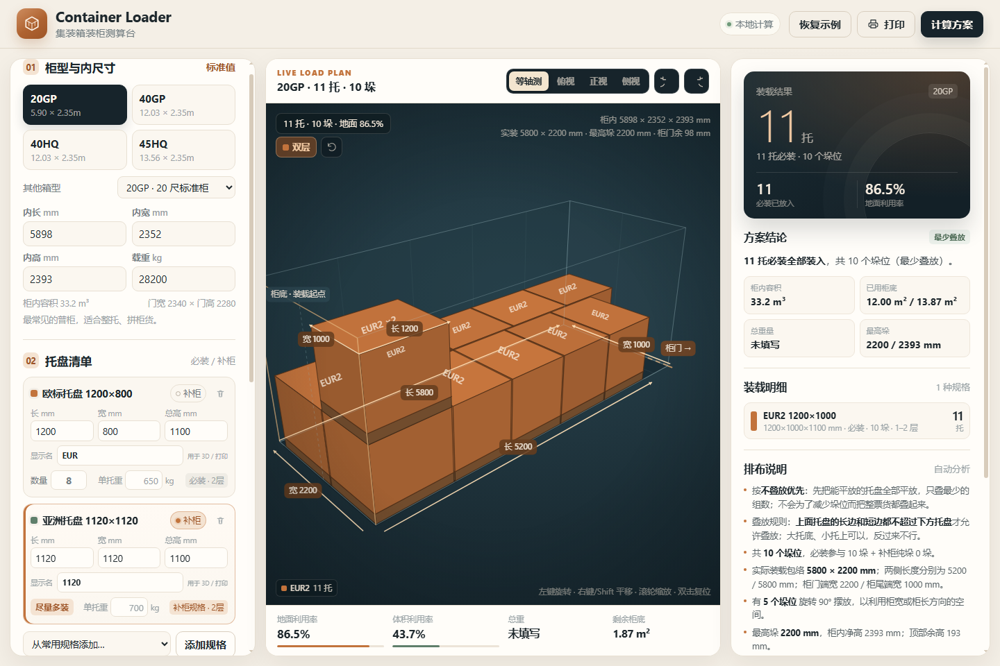
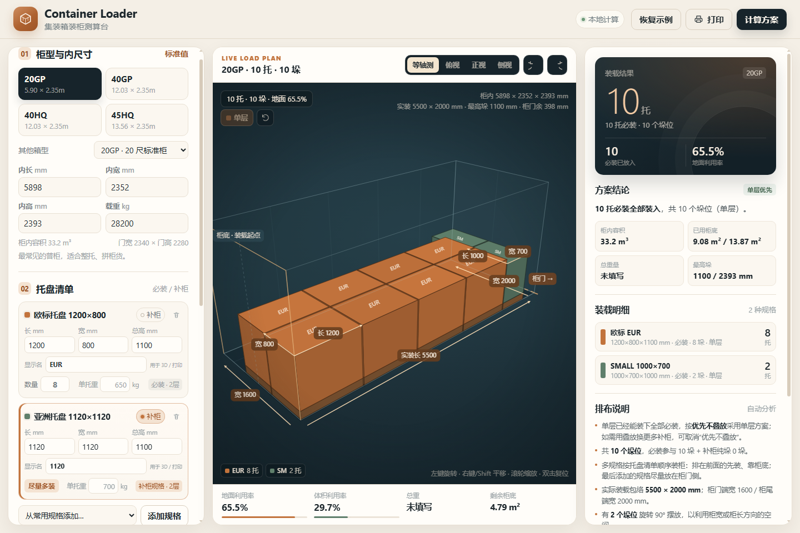
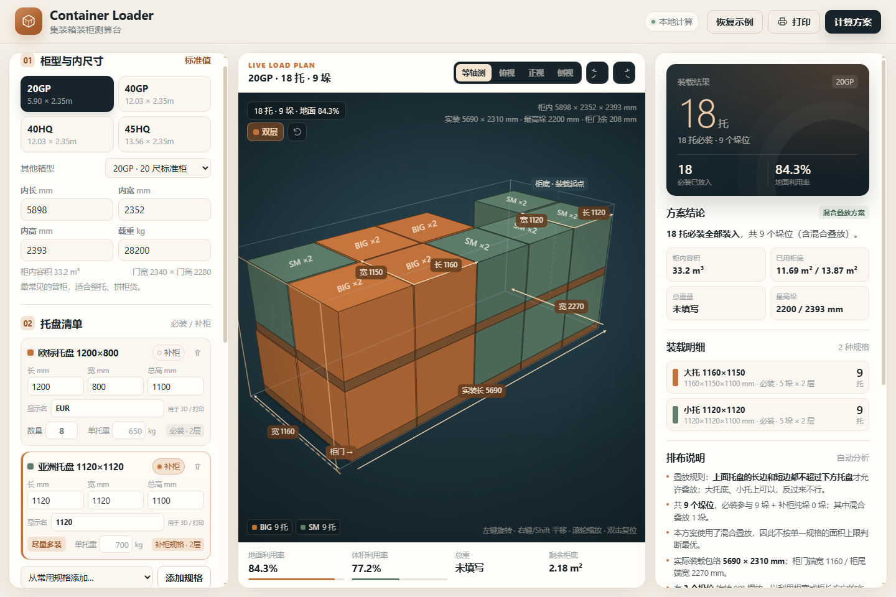
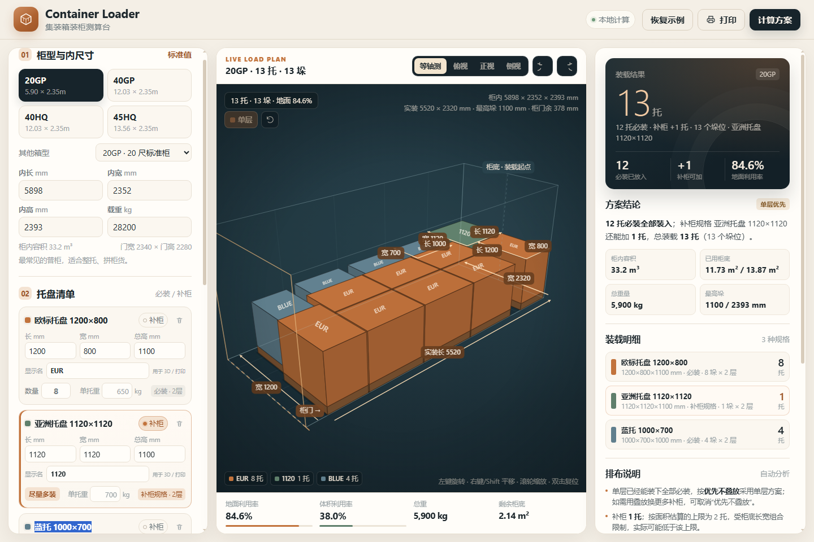
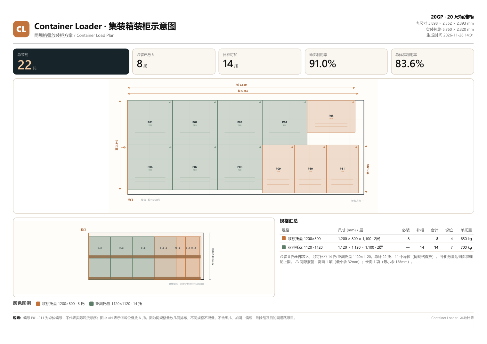

# Container Loader

**集装箱装柜测算台** — 给托盘货算一个能落地的装柜方案：必装多少、补柜最多还能加多少、3D 长什么样、打印出来怎么装。

界面语言参考了 Palletizer 的奶油纸色、深青柜体和陶土强调色，但这是一个独立的纯前端工具：**不依赖服务器、不依赖第三方 JS 库、数据不出本机**。

> GitHub：<https://github.com/taneli888/ContainerLoader>


---

## 先看用户给的这个例子

> 20 尺集装箱，8 个 1200×800×1100 的托盘必须装进去，除此之外还能装多少个 1120×1120×1100 的托盘？

按默认的 **“不叠放优先”** 策略（单层放得下全部必装就不叠）：

- **8 托必装全部装入**
- **1120×1120 补柜还能加 4 托**
- **总计 12 托、12 个单层垛位，地面利用率 91.5%，最高 1100mm**

如果点 **“叠放优先”**，工具会先叠放，同样场景变成：

- 8 托 EUR 叠成 4 个 2 层垛；
- 1120 补柜加到 14 托（7 个 2 层垛）；
- 总计 **22 托、11 个垛位，最高垛 2200mm**。

默认单层方案的尺寸：

- 实装包络 **5680 × 2320mm**，都小于 20GP 内长 5898mm / 内宽 2352mm；
- 两侧长度分别是 **5600 / 5680mm**，3D 和打印图上分别标注；
- **柜底贴紧对齐**，余量留在柜门侧（默认约 218mm，可在“柜门预留”里设最小值）；
- 单层/矮垛排在靠柜门一侧，高垛靠柜底一侧；装载从柜底开始，向柜门推进。

> 如果关闭“允许叠放”，同样只能得到 12 托 / 4 托补柜。叠放规则是 **大托底、小托上**：上层托盘的长边和短边都不能超过下层，反过来不行。

**“不叠放优先”不是“能叠就全叠”**：单层放不下时，只叠最少的组数。  
例如 11 个 1200×1000：

- 不叠放优先：**1 组双层 + 9 个平放 = 10 个垛位**；
- 叠放优先：**5 组双层 + 1 个单层 = 6 个垛位**。





---

## 直接开始

### 方式一：双击启动（推荐，无黑窗口）

双击：

```
启动 Container Loader.vbs
```

它会用默认浏览器打开 `index.html`，不弹 cmd 控制台。工作区约定里的 `.vbs` 隐藏窗口启动方式。

### 方式二：直接打开

双击 `index.html` 也可以。所有脚本都是普通 `<script>`，`file://` 下能运行，不依赖构建工具。

### 方式三：本地 HTTP 服务

```bash
cd container-loader
python -m http.server 8777
```

浏览器打开 <http://127.0.0.1:8777/>。用 HTTP 打开时，`manifest.webmanifest` 和“添加到主屏幕”才会按 PWA 方式工作。

---

## 上线与安装到手机

**在线地址（GitHub Pages，已开启）：**

### <https://taneli888.github.io/ContainerLoader/>

### iPhone / iPad（Safari）

1. 用 **Safari** 打开上面的网址（不要用微信内置浏览器）；
2. 点底部分享按钮；
3. 选 **“添加到主屏幕”**；
4. 桌面会出现 Container Loader 图标，之后从主屏幕打开就是全屏 App。

### Android（Chrome / Edge）

1. 用 Chrome 或 Edge 打开网址；
2. 点右上角菜单；
3. 选 **“安装应用”** 或 **“添加到主屏幕”**；
4. 桌面出现图标后，像普通 App 一样打开。

### 离线使用

页面内置了 `sw.js`：第一次在线打开后，会把 HTML / CSS / JS / 图标缓存到手机；之后断网也能打开已经缓存过的版本。更新页面后如果手机仍显示旧版，关闭 App 重新打开，或刷新一次即可。

> `file://` 直接打开可以正常计算，但 **不能安装成 PWA**；要装到手机主屏幕，请用上面的 HTTPS 地址。

---

## 功能

- **内置 8 种常见箱型**：20GP / 40GP / 40HQ / 45HQ / 20RF / 40RF / 20OT / 40OT，并可改内尺寸与载重；
- **内置 9 种常用托盘**：EUR、EUR2、亚洲 1100、1120 方托、GMA、美式 48×48、1200 方托、1140 方托、半托；
- **自定义托盘**：新建后自动加入“常用规格”下拉列表；名称、显示名（3D/打印简称）、长宽高、单托重、数量都可编辑；卡片右上角垃圾桶删除；点“管理自定义规格”可集中删除不再用的预设；
- **常用规格下拉**：内置规格 + 我的自定义规格；改了自定义规格的名称/尺寸后，下拉列表会同步更新；
- **界面字体整体放大**：所有主要标签、输入框、结果与 3D 标注统一放大，手机上也更易读；
- **风车型候选**：20GP + 1200×1000 内置双排风车排布，每层 10 托；2 层可放 20 托（普通横竖排法放不下）；
- **多规格全局重排**：每次增删改都重算整柜；多层垛集中柜底，单层垛集中柜门侧，小规格高层垛优先填大托之间的空隙；
- **叠放安全分区**：多层垛先集中排柜底，单层垛集中排柜门侧，单层不会夹在两层垛中间；
- **装载策略按钮**：“不叠放优先 / 叠放优先”两档；默认先试单层，单层放不下时只叠最少的组数；选“叠放优先”才按最大叠放；
- **最少叠放**：11 个 1200×1000 在不叠放优先下是 1 组双层 + 9 个平放，不会直接叠成 6 个垛位；
- **混合叠放规则**：大托底、小托上；上层托盘的长边和短边都不能超过下方托盘，反过来不行；
- **装载方向**：每个纵向通道都向 **柜底** 对齐，从柜底向柜门装载；余量留在柜门，单层/矮垛排在最靠柜门的外侧；
- **补柜按钮可反复切换**：按下时计算该规格最多能补多少托；再按一次取消补柜、恢复数量输入，按实际数据填写；
- **3D 装柜演示**：等轴测 / 俯视 / 正视 / 侧视，左键旋转、右键或 Shift 拖动平移、滚轮/双指缩放、双击复位；
- **手动调整托盘**：点 3D 左上“手动”，拖动任意托盘垛；靠近柜内壁或其它托盘边缘时自动吸附，只接受不碰撞、不越柜体的位置，空白处仍可旋转视角；“旋转 90°”或 `R` 键会先转方向，再自动找最近的空位；找不到空位才提示放不下；选中后还可用 **↑前 / ←左 / →右** 方向键让托盘一次贴到对应柜壁或托盘边缘（没有“下”，柜门方向不吸附）；
- **持续旋转按钮**：3D 顶栏右侧两个圆弧按钮；按一次持续顺时针/逆时针旋转，再按停止，按钮高亮显示当前方向；
- **3D 尺寸标注**：托盘长/宽用箭头标注；实际装载包络的总长/总宽用长箭头标注，两侧长度或两端宽度不一致时分别显示；
- **柜底 / 柜门标注**：3D 和打印图上明确标出“柜底·装载起点”和“柜门”；
- **间隙报警**：同排宽度余量 <80mm、同列长度余量 <200mm 时，结果区红色/橙色提示具体排/列；
- **双层显示开关**：3D 左上角“双层/单层”可以切换查看上层托盘；
- **A4 横向打印图**：俯视编号图 + 侧视图 + 规格汇总表，浏览器“打印 → 另存为 PDF”即可，已压到单页；
- **移动端**：iPhone / iPad 单列布局，底部“录入 / 3D / 结果”Tab；
- **本地保存**：录入内容自动存到 `localStorage`，下次打开继续；
- **方案导出**：结果可导出 JSON，方便留档或二次处理。






---

## 界面怎么用

1. **选柜型**：点 20GP / 40GP / 40HQ / 45HQ，或在“其他箱型”里选冷柜、开顶柜、自定义。
2. **填托盘**：点“添加规格”从常用规格里选，或“新建自定义托盘”；自定义托盘添加后会自动选中名称，可直接命名。下拉列表下方“管理自定义规格”可以删除预设（已添加的托盘卡片会保留）。
3. **选装载策略**：默认“不叠放优先”，单层放得下全部必装就不叠；点“叠放优先”则先叠放。叠放层数按柜内净高自动计算。
4. **指定补柜**：点某一行的“补柜”按钮，进入“尽量多装”模式；再点一次取消，数量输入框恢复，按实际数量填写。
5. **算**：点左下“计算装载方案”或右上“计算方案”。
6. **看 3D / 结果**：桌面端三栏同时可见；手机用底部 Tab。3D 左上角可以切换“双层/单层”显示。需要微调时点“手动”，拖动托盘；碰撞/越界会被挡住，按 `R` 旋转选中托盘。选中后 3D 左侧出现 **↑前 / ←左 / →右**，键盘的 **↑ / ← / →** 对应同样方向：前是贴柜底方向，左/右贴对应内壁或托盘边缘；没有向下（柜门）吸附。
7. **打印**：点右上“打印”或结果面板底部“打印 A4 装箱图”。

> “补柜”的含义：先保证所有非补柜行的数量全部装进去，再把补柜行尽量多装。补柜数量不受数量输入限制；取消补柜后，这一行就按实际数量作为必装。


---

## 内置箱型（参考值，可编辑）

| 箱型 | 内长 × 内宽 × 内高 (mm) | 载重 (kg) | 门宽 × 门高 (mm) |
|---|---:|---:|---:|
| 20GP | 5898 × 2352 × 2393 | 28,200 | 2340 × 2280 |
| 40GP | 12032 × 2352 × 2393 | 26,700 | 2340 × 2280 |
| 40HQ | 12032 × 2352 × 2698 | 26,500 | 2340 × 2585 |
| 45HQ | 13556 × 2352 × 2698 | 27,700 | 2340 × 2585 |
| 20RF | 5449 × 2295 × 2265 | 27,700 | 2290 × 2224 |
| 40RF | 11583 × 2295 × 2250 | 26,000 | 2290 × 2224 |
| 20OT | 5898 × 2352 × 2340 | 28,000 | 2340 × 2280 |
| 40OT | 12032 × 2352 × 2340 | 26,700 | 2340 × 2280 |

> 不同船公司、不同箱号的内部尺寸和载重会有差异；冷柜还有风道、T 地板等影响。装柜前请以实际箱门铭牌 / 船公司数据复核，界面里的数字都可以直接改。

## 内置托盘

| 规格 | 尺寸 (mm) | 说明 |
|---|---:|---|
| EUR | 1200 × 800 | 欧洲最常用 |
| EUR2 | 1200 × 1000 | 工业托盘 |
| ASIA | 1100 × 1100 | 中日韩常见 |
| 1120 | 1120 × 1120 | 本示例补柜规格 |
| GMA | 1219 × 1016 | 48 × 40 英寸 |
| 48×48 | 1219 × 1219 | 美式方托 |
| 1200 | 1200 × 1200 | 通用方托 |
| 1140 | 1140 × 1140 | 部分亚洲航线 |
| HALF | 800 × 600 | 半托 / 小件 |

托盘默认总高 1100mm，木底高度 144/140mm 仅用于 3D 外观；实际录入时以**含托盘的货物总高**为准。

---

## 求解逻辑与边界

整个计算分成两层：

1. **竖向**：先按“不叠放优先”尝试全部单层；单层放不下全部必装，或用户选择“叠放优先”时，才按 **大托底、小托上** 的规则形成混合垛；
2. **柜底**：把一个“垛位”当成一个底面矩形，在柜底做 2D 排布；必装先满足，再最大化补柜托数；
3. **方向**：整票货贴紧柜底，余量留柜门；单层/矮垛排在外侧（柜门一侧）。

具体规则：

- 单层能装下全部必装时，默认不叠；无补柜时“叠放优先”不会无意义地全叠；
- 必装“不叠放优先”和补柜叠放解耦：补柜按柜内净高独立叠层，不再被必装的单层策略砍半；
- 同长宽高的必装规格会先合并计算，界面提示合并行；
- 混合叠放会主动生成“大底 + 小上”候选；上托长宽都不超过底托时不会悬空，例如 1160×1150 底托可承载 1120×1120 上托；
- 补柜数量 = 补柜层数总和（尽量满垛）；
- 每个托盘底面可旋转 90°（默认允许，可关闭）；
- 目标不是“总体积最大”，而是“补柜托数最多”，因为实际业务通常按托数结算；
- 必装数量在界面里是实际托盘数，不是垛位数；结果会同时显示“托”和“垛”；
- 间隙按相邻托盘之间的净距计算，最后紧凑化也保留净距；
- 柜门预留是硬约束，任何候选都不能侵入 `L - doorGap`；
- 单托高度超过柜门高直接拒绝；叠放后垛高超过门高给出“柜内分拆”提示。

> 风车候选目前内置的是 **20GP + 1200×1000** 的双排风车（10 托/层）；其他尺寸仍走条带 / 混合叠放搜索，不能保证找到每层最多的风车排法。

### 坐标系与二次紧凑化

- **X = 0 是柜底（封闭端、装载起点），X = L 是柜门**；
- **Y = 0 是左侧内壁，Y = W 是右侧内壁**；
- **Z = 0 是柜底，Z = H 是柜顶**；
- 所有 `placements` 都使用毫米级真实坐标，3D / 打印直接读取，不在渲染阶段重新居中或均分；
- 初始排布后执行二次紧凑化：每个垛位先向 X=0 顶到托盘/柜底，再向 Y=0 顶到托盘/侧壁；用真实矩形碰撞检测，重复到不能移动；
- 最后重新计算柜底空隙 `bottomGap` 和柜门余量 `doorClearance`。

### 多规格与柜底利用率优先

- 多规格不再按“清单先后”或“面积从小到大”排柜底；
- 先尝试全部单层；放不下时，多规格也会搜索“地面垛位最多”的叠放组合，而不是直接全部叠两层；
- 会对规格先后顺序做多种排列，分别生成高层集中柜底的候选布局；
- 用**柜底侧空缝评分**选择方案：靠柜底的宽度空缝权重更高，柜门侧允许留空；
- 多层垛集中柜底，单层垛集中柜门侧；在同等托数下，优先选择柜底宽度覆盖最大、内部空缝最小的方案；
- 只有在总托数（含补柜）不减少时才采用该候选，避免为了布局美观牺牲装载量。
- 这是启发式“高层分区 + 小规格填隙”，不是完整的叉车路径仿真；如果尺寸导致候选放不下，会退回全局条带方案，并在结果里保留实际坐标。

可运行空间审计：

```bash
node tools/layout-audit.js
```

输出每个托盘的 X/Y/长/宽/旋转角，并检查碰撞、越界、内部 X 空隙、是否还能向柜底/左壁移动、柜门余量。

求解器采用：

1. 沿柜宽方向枚举切分位置，把柜底切成上下两条长条；
2. 每条长条内，枚举“沿宽度并排若干垛位”的条带模式，用 DP 沿柜长排布；
3. 枚举必装垛位在两条长条中的数量分配；
4. 用必装面积、剩余长度、补柜面积上限做剪枝；
5. 复杂规格最多使用约 1.2 秒 CPU 时间，超时返回当前最佳方案。

**关于“最优”**：

- 如果补柜数量达到 `floor((柜底面积 - 必装垛位面积) / 补柜垛位面积) × 补柜层数`，且没有混合叠放，界面显示“达到面积上限”；否则是“条带搜索方案”，不保证数学最优；
- 混合叠放（大底小上）会突破“单一规格满垛”的面积上限，所以含混合叠放时界面显示“混合叠放方案”，不声称最优；
- 这不是 CP-SAT / MILP 证明器；它的优势是纯前端、秒级、结果可解释。

**间隙报警规则**（按实际装载坐标计算）：

- 同一**排**（相同柜长起点）的托盘宽度之和，距离柜内宽不足 **80mm** 时报警；
- 同一**列**（相同柜宽起点）的托盘长度之和，距离柜内长不足 **200mm** 时报警；
- 报警只是提示“现场操作余量偏小”，不会阻止方案生成；可以在结果区和打印图里看到具体是哪一排 / 哪一列。

**不包含**：

- 货架式叠层、不同规格但上大下小的违规叠放；
- 偏载、重心、轴重、目的国道路限重；
- 绑扎、加固、危险品隔离、冷柜风道避让；
- 托盘实际变形、货物超出托盘、叉车操作空间的三维仿真。

这些需要专业装柜软件或现场工程师复核。叠放计算默认假设托盘可以安全承重；不能承重的货请关闭“允许叠放”。

---

## 打印

点“打印”后使用浏览器打印对话框：

- 纸张：**A4 横向**；
- 建议勾选“背景图形 / Background graphics”；
- 目标打印机选“另存为 PDF”即可得到可转发的装柜图。

打印内容：

1. 柜型、内尺寸、**实际装载包络**、生成时间；
2. 总托数、必装、补柜、地面利用率、体积利用率；
3. 带 P01…编号的俯视排布图（颜色区分规格，`×N` 表示该垛位叠 N 托）；
4. **实际总长/总宽长箭头**；两侧长度不一致时分别标注，柜门端 / 柜尾端宽度不一致时分别标注；
5. 侧视图（按叠放层数绘制）；
6. 规格汇总表（尺寸/层、必装、补柜、合计、垛位、单托重）；
7. 间隙报警、免责声明与“编号不代表卸货顺序”的说明。



---

## 测试

```bash
node tools/solver-test.js
```

当前覆盖 153 项断言：默认必装不叠 + 补柜双层 16 托 / 8 托补柜、叠放优先 22 托 / 14 托补柜、11 个 1200×1000 的“1 组双层 + 9 个平放”、8/11/12 托 EUR、1120 单规格允许叠放 20 托、20GP 20 托 1200×1000 风车、3 托短通道柜底对齐、WODA+EUR 柜底利用率与单层分区、40HQ、20mm 间隙、柜门预留、禁止旋转、自定义规格、同尺寸合并、门高拒绝、大底小上混合叠放等；每个方案都检查越界 / 重叠 / 必装数量 / 垛位数。

独立验收（不依赖界面统计字段）：

```powershell
node tools/acceptance/verify.js   # P0/P1 门禁，必须全过
node tools/acceptance/run.js      # 报告里的 29 个场景 + 容量/补柜对照
```

`verify.js` 覆盖：补柜双层、同尺寸 6+6 合并、多规格最少叠放、40HQ 30 托、50mm 净间隙、300mm 柜门预留、2350mm 门高拒绝。


浏览器回归（需要先启动 8777 端口服务，Windows Edge 路径写在脚本里）：

```bash
python -m http.server 8777
node tools/browser-test.js
```

会输出桌面 / 平板 / 手机 / 打印媒体截图到 `tests/`，并检查控制台异常、横向溢出、托盘点击选中、拖拽旋转 / Shift 平移 / 滚轮缩放、双层切换、补柜按钮切换、自定义托盘新增 / 删除、40HQ 切换、超量报错等。

---

## GitHub 调研记录

做之前看了这些项目 / 资料，主要确认“装柜工具应该有哪些能力”和“有没有现成轮子可以直接用”：

- [Palletizer.app](https://palletizer.app/)：商业化的 3D 托盘 / 装柜排布服务，交互和视觉是主要参考；
- [palletizer-app/go-sdk](https://github.com/palletizer-app/go-sdk)：Palletizer 的官方 Go SDK，说明它的核心是 3D bin packing API；
- [GitHub `container-loading` topic](https://github.com/topics/container-loading)：里面有 Loadplan 柜算（免费开源装柜工具，支持 20GP / 40GP / 40HQ、纸箱 / 整托、3D、Excel / PDF）；
- [GitHub `3d-packing` topic](https://github.com/topics/3d-packing)：大量 3D bin packing / 装箱开源实现；
- [@cratefit/pack](https://www.jsdelivr.com/package/npm/@cratefit/pack)：可直接用的 JS 3D 装箱库；
- [packvium/packvium-node](https://github.com/packvium/packvium-node)：Node.js 3D cartonization 引擎。

最后没有直接引入这些库，原因是：

1. 用户的核心诉求是**托盘按托数装柜**，不是纸箱级 3D 装箱；把同规格/大底小上的托盘合成“垛位”后，在柜底做 2D 排布才是决定数量的关键；
2. 通用 3D bin packing 库通常按体积 / 重量优化，不直接支持“必装 + 补柜最大化”的业务目标；
3. 纯 Canvas 2D 3D 渲染 + 自写条带 DP 可以做到零依赖、离线打开、打印可控，和这个工作区的本地工具箱约定更匹配。

如果以后要做纸箱级混装、叠层、重心 / 轴重，建议在这个模型上增加 3D 层，或接入 OR-Tools CP-SAT / Palletizer API。

---

## 文件结构

```
container-loader/
├─ index.html                 页面入口
├─ 启动 Container Loader.vbs  无控制台启动
├─ manifest.webmanifest       PWA manifest
├─ sw.js                      Service Worker（离线缓存）
├─ css/style.css              界面 / 响应式 / 打印样式
├─ js/data.js                 箱型、托盘预设、示例
├─ js/solver.js               不叠放优先 / 大底小上混合叠放 + 柜底 2D 求解器
├─ js/render3d.js             Canvas 2D 3D 渲染
├─ js/plan.js                 俯视图 / 侧视图 / A4 打印
├─ js/app.js                  交互与状态
├─ icons/                     favicon / PWA 图标
├─ docs/                      README 截图
└─ tools/
   ├─ solver-test.js          求解器回归
   └─ browser-test.js         Edge CDP 浏览器回归
```

## 部署到 GitHub Pages

这个仓库已经启用 GitHub Pages：**<https://taneli888.github.io/ContainerLoader/>**。

以后更新代码只需要：

1. 修改后 `git add -A && git commit -m "..." && git push`；
2. 等 1–2 分钟 GitHub Pages 自动重新部署；
3. 手机刷新或重新打开 PWA 即可拿到新版本。

如果换一个新仓库，流程是：

1. 把 `container-loader/` 里的全部文件放到仓库根目录；
2. 仓库 Settings → Pages → Deploy from a branch；
3. 选择分支和 `/ (root)`；
4. 打开 `https://<用户名>.github.io/<仓库名>/`。

如果部署在子目录，`manifest.webmanifest` 和页面里的相对路径都能工作；`sw.js` 没有内置，离线能力取决于浏览器缓存。需要完整离线 PWA 时可以再加一个 Service Worker。

## 兼容性

- 桌面 Edge / Chrome / Safari 现代版本；
- iPhone Safari iOS 16+（`ResizeObserver`、Pointer Events、Canvas 2D）；
- 3D 使用 Canvas 2D，不依赖 WebGL，老一些的集显 / 远程桌面也能显示；
- 打印在 Edge / Chrome 的“另存为 PDF”下验证过 A4 横向单页。

---

## 一句话总结

**Container Loader：先保证必装，再算补柜；3D 看得懂，A4 打得出来，数据不出本机。**


